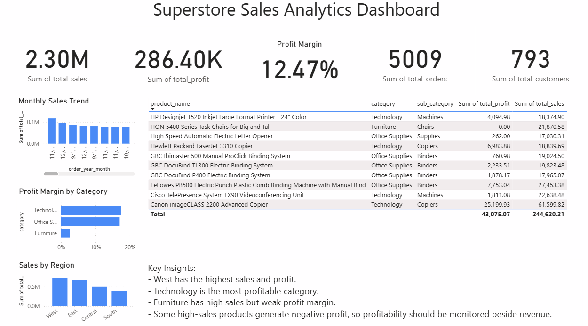
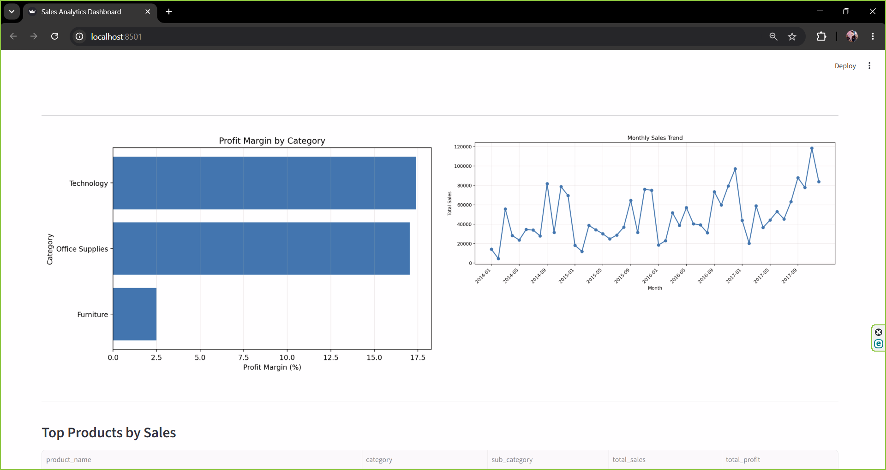
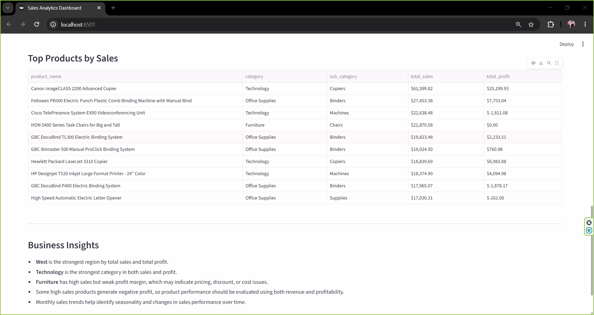

# Sales Analytics Dashboard

An end-to-end business analytics portfolio project built with **Python, SQL, SQLite, Pandas, Power BI, and Streamlit**.

The project analyzes historical Superstore sales data to evaluate revenue, profitability, regional and product performance, monthly growth, and discount-related business risks.

It demonstrates data preparation, SQL analytics, window functions, dashboard development, business interpretation, and automated validation.

## Project Highlights

- End-to-end data cleaning and SQLite database creation
- Business KPI reporting and profitability analysis
- Advanced SQL with CTEs and window functions
- Month-over-month (MoM) growth using `LAG()`
- Three-month rolling averages using `AVG() OVER`
- Product ranking with `DENSE_RANK()` and `NTILE(4)`
- Discount-band profitability and loss analysis
- High-sales, low-profit product identification
- Power BI and Streamlit dashboards
- Reproducible CSV exports and automated tests

## Dataset

The project uses a historical Superstore sales dataset covering **January 2014 through December 2017**.

| Metric | Value |
|---|---:|
| Sales records | 9,994 |
| Original columns | 21 |
| Unique orders | 5,009 |
| Unique customers | 793 |
| Months analyzed | 48 |

Key fields include order dates, customer details, regions, categories, product identifiers, sales, quantity, discount, and profit.

The original dataset is excluded from the repository. Place the source CSV in `data/raw/superstore.csv` to rebuild the analysis from raw data.

## Project Structure

```text
sales-analytics-dashboard/
|
|-- app/
|   `-- streamlit_app.py
|
|-- data/
|   |-- raw/
|   `-- processed/
|
|-- powerbi/
|   |-- superstore_sales_dashboard.pbix
|   |-- dashboard_screenshot.png
|   |-- streamlit_dashboard_kpis.png
|   |-- streamlit_dashboard_trends.png
|   `-- streamlit_dashboard_insights.png
|
|-- results/
|   |-- figures/
|   |-- main_kpis.csv
|   |-- sales_by_region.csv
|   |-- sales_by_category.csv
|   |-- monthly_sales_trend.csv
|   |-- top_products_by_sales.csv
|   |-- advanced_monthly_sales.csv
|   |-- discount_band_analysis.csv
|   `-- high_sales_low_profit.csv
|
|-- scripts/
|   `-- export_advanced_reports.py
|
|-- sql/
|   |-- sales_kpi_queries.sql
|   |-- advanced_sales_analysis.sql
|   |-- product_profitability_analysis.sql
|   |-- high_sales_low_profit.sql
|   |-- discount_profit_analysis.sql
|   `-- discount_band_analysis.sql
|
|-- src/
|   |-- __init__.py
|   |-- config.py
|   |-- data_loader.py
|   |-- cleaning.py
|   |-- database.py
|   |-- analysis.py
|   `-- visualization.py
|
|-- tests/
|   |-- test_business_metrics.py
|   `-- test_product_ranking.py
|
|-- .gitignore
|-- main.py
|-- README.md
`-- requirements.txt
```

The SQLite database is generated locally and is not required to be committed to Git.

## Analytics Workflow

### 1. Data Loading and Cleaning

The Python pipeline:

1. Loads the raw Superstore CSV.
2. Standardizes column names and data types.
3. Parses order and shipping dates.
4. Handles duplicate records.
5. Creates year, month, and year-month features.
6. Calculates profit-margin features.
7. Stores cleaned records in SQLite.

The cleaned data is saved in the `sales` table of `sales_analytics.db`.

### 2. Core SQL Analytics

The file `sql/sales_kpi_queries.sql` contains SQL analyses for:

- Overall sales, profit, orders, and customers
- Sales and profitability by region
- Sales and profitability by category
- Monthly sales trends
- Top-selling and most profitable products
- Customer segments
- Discounts and profitability
- State-level sales performance

### 3. Advanced Monthly Sales Analysis

File: `sql/advanced_sales_analysis.sql`

This analysis uses:

- Common Table Expressions (CTEs)
- `LAG()` for previous-month sales
- Month-over-month growth percentages
- `AVG() OVER` with a three-row window
- `COUNT() OVER` to require a complete rolling window

**MoM Growth**

```text
MoM Growth (%) =
(Current Month Sales - Previous Month Sales)
 / Previous Month Sales * 100
```

**Three-Month Rolling Average**

```text
Rolling Average =
(Current Month Sales
 + Previous Month Sales
 + Sales Two Months Earlier) / 3
```

The first month has no prior-month growth value. The first two months have no complete three-month rolling average.

The dashboard displays actual monthly sales and the rolling average together.

### 4. Product Profitability and Ranking

Files:

- `sql/product_profitability_analysis.sql`
- `sql/high_sales_low_profit.sql`

The analysis evaluates products using total sales, total profit, profit margin, order count, and sales rankings.

Advanced SQL techniques include:

- `DENSE_RANK()` for product sales rankings
- `NTILE(4)` for grouping products into sales quartiles
- CTEs for intermediate calculations
- Company-wide profit margin as a benchmark

The priority report identifies up to 20 products in the highest sales quartile whose profit margins are below the company-wide margin, ordered by monetary profit/loss.

### 5. Discount and Profitability Analysis

Files:

- `sql/discount_band_analysis.sql`
- `sql/discount_profit_analysis.sql`

Discounts are analyzed in six groups:

| Discount band |
|---|
| 0% |
| 0–10% |
| 10–20% |
| 20–30% |
| 30–50% |
| Above 50% |

The analysis calculates:

- Number of order lines
- Distinct orders within each band
- Total sales and total profit
- Profit margin
- Average discount
- Percentage of loss-making order lines

The discount analysis is observational. It does not establish that discounts cause changes in profitability.

A single order may contain lines in multiple discount bands, so distinct order counts should not be summed across bands.

## Key Results

### Overall Business KPIs

| KPI | Value |
|---|---:|
| Total Sales | $2,297,200.86 |
| Total Profit | $286,397.02 |
| Total Orders | 5,009 |
| Total Customers | 793 |
| Overall Profit Margin | 12.47% |

### Regional Performance

| Region | Total Sales | Total Profit | Profit Margin |
|---|---:|---:|---:|
| West | $725,457.82 | $108,418.45 | 14.94% |
| East | $678,781.24 | $91,522.78 | 13.48% |
| Central | $501,239.89 | $39,706.36 | 7.92% |
| South | $391,721.91 | $46,749.43 | 11.93% |

The West region has the highest total sales and profit. Central has the lowest profit margin.

### Category Performance

| Category | Total Sales | Total Profit | Profit Margin |
|---|---:|---:|---:|
| Technology | $836,154.03 | $145,454.95 | 17.40% |
| Furniture | $741,999.80 | $18,451.27 | 2.49% |
| Office Supplies | $719,047.03 | $122,490.80 | 17.04% |

Furniture generates substantial sales but has a relatively low profit margin.

### Advanced Monthly Sales Findings

For December 2017:

| Metric | Value |
|---|---:|
| Monthly Sales | $83,829.32 |
| Month-over-Month Growth | -29.23% |
| Three-Month Rolling Average | $93,351.35 |

The highest observed MoM growth was **+1132.13% in March 2014**.

Large growth percentages can result from a low previous-month baseline and should be interpreted carefully.

### Discount Analysis Findings

| Metric | Value |
|---|---:|
| Profit Margin Without Discount | 29.51% |
| Profit Margin Above 50% Discount | -119.20% |
| Loss-Making Lines Above 50% Discount | 100.00% |

Higher discount bands are associated with weaker profit margins in this dataset.

Differences in product mix, costs, and other factors may contribute to this relationship.

### High-Sales, Low-Profit Findings

The priority report contains 20 products, all of which have negative total profits in the current output.

The largest monetary loss among these products belongs to:

**Cubify CubeX 3D Printer Double Head Print**

- Total loss: **-$8,879.97**
- Profit margin: **-80.00%**

These products are candidates for further investigation of pricing, discounts, costs, and product-level profitability.

The report is limited to 20 selected products; it does not represent the complete product catalog.

## Dashboards

### Power BI Dashboard

The Power BI report includes:

- Main business KPIs
- Regional and category analysis
- Monthly sales performance
- Product performance
- Business insights

Power BI file:

`powerbi/superstore_sales_dashboard.pbix`



### Streamlit Dashboard

The Streamlit app includes:

- Main KPI cards
- Sales by region and category
- Category profitability
- Monthly sales trends
- Actual sales versus three-month rolling average
- Latest MoM growth
- Highest and lowest observed monthly growth
- Top products by sales
- Discount and profitability analysis
- High-sales, low-profit product analysis
- Detailed tables and business interpretations

Existing dashboard screenshots:






The screenshots are snapshots and may not include every feature in the latest application.

## How to Run

### 1. Clone the Repository

```bash
git clone https://github.com/Zahra-ziaee/sales-analytics-dashboard.git
cd sales-analytics-dashboard
```

### 2. Create a Virtual Environment

On Windows CMD:

```cmd
python -m venv .venv
.venv\Scripts\activate
```

### 3. Install Dependencies

```cmd
python -m pip install -r requirements.txt
```

### 4. Add the Dataset

Place the source Superstore CSV at:

```text
data/raw/superstore.csv
```

The raw dataset is not bundled with this repository.

### 5. Run the Main Analytics Pipeline

```cmd
python main.py
```

This generates the cleaned data, local SQLite database, core CSV reports, and static visualizations.

### 6. Export Advanced SQL Reports

```cmd
python scripts/export_advanced_reports.py
```

This reads SQL queries from `sql/` and writes:

```text
results/advanced_monthly_sales.csv
results/discount_band_analysis.csv
results/high_sales_low_profit.csv
```

The export script requires the `sales` table in the local SQLite database.

### 7. Run Automated Tests

```cmd
python -m unittest discover -s tests -p "test_*.py" -v
```

The tests require the SQLite database and generated report CSVs.

### 8. Launch Streamlit

```cmd
python -m streamlit run app/streamlit_app.py
```

Open the local address printed by Streamlit, typically:

`http://localhost:8501`

## Testing and Validation

The project includes automated tests for:

**Monthly analytics**

- Monthly sales and profit totals
- Month-over-month growth
- Three-month rolling averages
- Consistency between Pandas calculations and SQL output

**Discount analysis**

- Order-line counts
- Distinct order counts within bands
- Sales and profit totals
- Discount-band profitability metrics
- Loss-making order-line percentages

**Product prioritization**

- Product-level aggregation
- Sales quartile assignment
- Sales rankings
- Selection and ordering of priority products

The current test suite contains three automated tests.

These tests verify selected calculations and reporting logic; they are not a guarantee of complete coverage.

## Business Recommendations

Based on the descriptive results, potential follow-up analyses include:

1. Investigate the Central region's lower profitability.
2. Review the furniture category's product mix and costs.
3. Examine products combining strong sales with negative profit.
4. Compare discounted and non-discounted sales after accounting for product and order characteristics.
5. Investigate monthly sales variability and potential seasonal patterns.

Recommendations identify areas for investigation, not proven effects of interventions.

## Technologies

- Python
- SQL
- SQLite
- Pandas
- NumPy
- Matplotlib
- Streamlit
- Power BI
- unittest
- Git and GitHub

## Possible Future Improvements

- Interactive customer-segment filters
- Customer-level retention and purchase-frequency analysis
- State-level geographic visualization
- Deeper seasonality analysis
- Additional business KPI tests
- Automated report regeneration and CI

## Author

**Zahra Ziaee**

M.Sc. Computer Science – Data Mining

Focus: Data Science, SQL Analytics, Business Intelligence, Machine Learning, and Data-Driven Decision Making

GitHub: [Zahra-ziaee](https://github.com/Zahra-ziaee)
